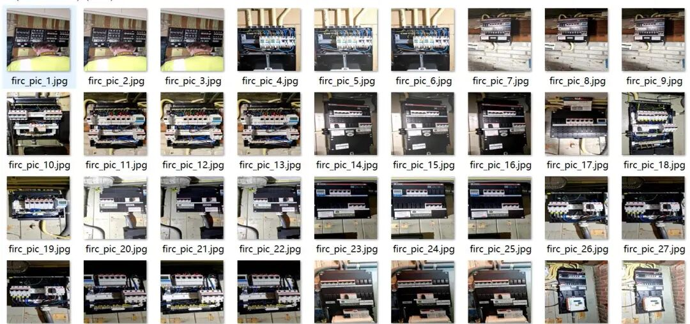
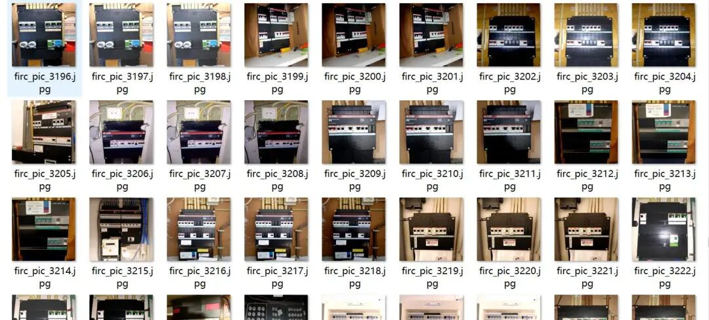
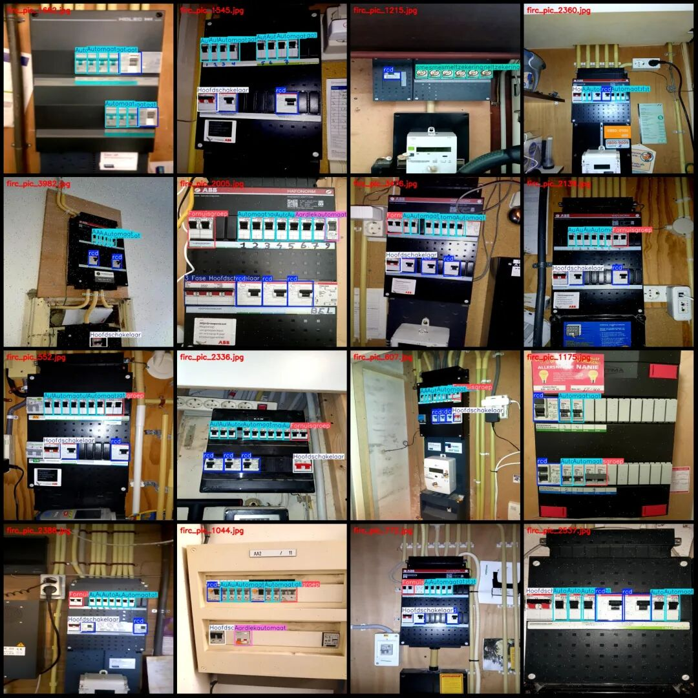
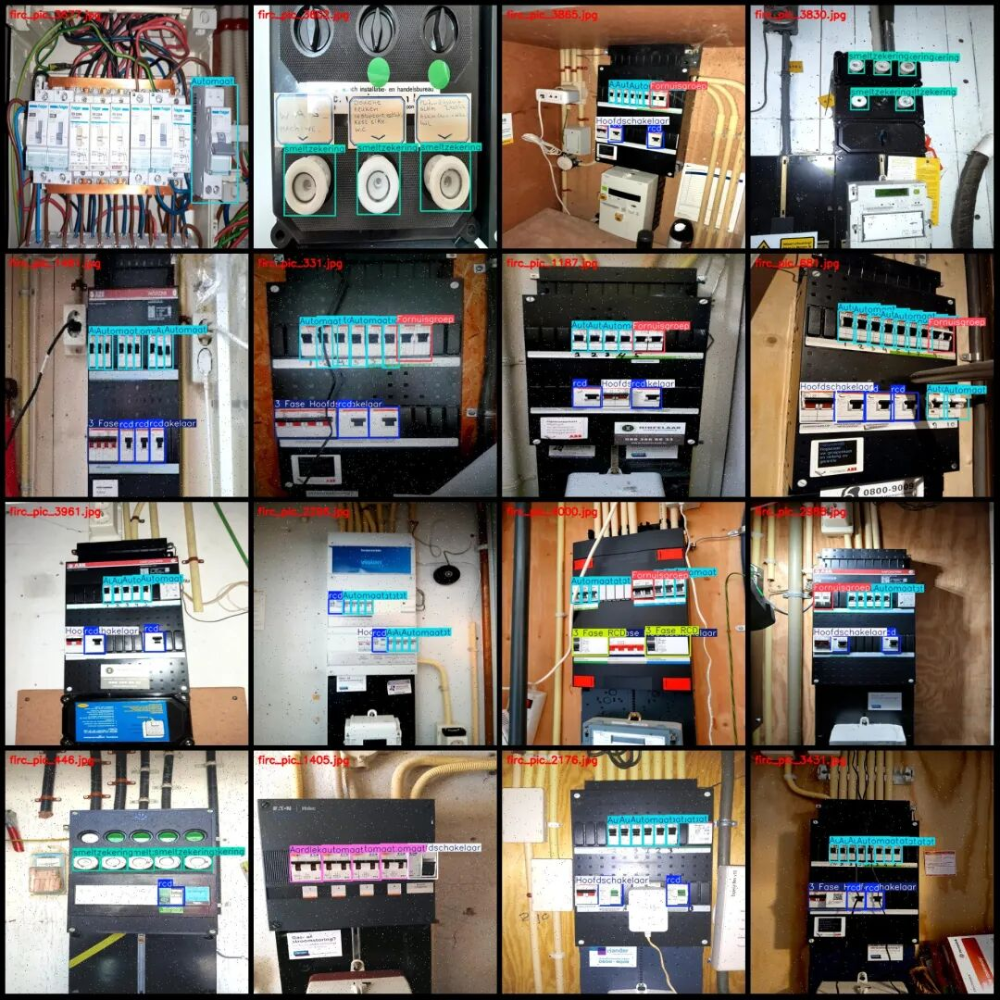

# Electrical Equipment Power Distribution Box Switch Protection Devices Outlet Testing Data Set VOC+YOLO Format with 4135 Images in 10 Categories with Enhanced Features

Please note that the images in the dataset have been enhanced; please refer to the image preview for details.

Dataset format: Pascal VOC format + YOLO format (txt file without split path, only containing jpg images and corresponding VOC format xml files and yolo format txt files)

Number of images (number of jpg files): 4135

Number of annotations (number of xml files): 4135

Number of annotations (number of txt files): 4135

Label category count: 10

Label category names (note that the order of labels in the YOLO format does not correspond to this, but is based on the "labels" folder's "classes.txt"): ["3 Fase", "3 Fase Hoofdschakelaar", "3 Fase RCD", "Aardlekautomaat", "Automaat", "Fornuisgroep", "Hoofdschakelaar", "rcd", "smeltzekering", "wcd"]

Number of boxes labeled in each category:

3 Fase (three-phase) Frames = 480

3 Fase Hoofdschakelaar (Three-phase Main Switch) Frames = 1037

3 Fase RCD (three-phase leakage protection device/RCD) Frames = 464

Aardlekautomaat (Leakage Current Relay) Frame Count = 736

Automaat (Circuit Breaker/Automatic Switch) Frame Count = 23162

Fornuisgroep (furnace group/cooking utensil group) Frames = 2029

Hoofdschakelaar (main switch) frame count = 2000

RCd (Leakage Current Relay/RCD) frame count = 7195

Smeltzekering (fuse) frame count = 3519

WCD (Wall Socket/WCD) Frame Count = 47

Total frame count: 40669

Number of images per category:

3 Fase (three-phase) occupancy count = 243

3 Fase Hoofdschakelaar (Three-phase Main Switch) occupancy = 1017

3 Fase RCD (three-phase leakage protection device/RCD) occupancy rate = 237

Aardlekautomaat (Leakage Current Circuit Breaker) occupies a picture count = 360

Automaat (circuit breaker/automatic switch) occupies = 3672

Fornuisgroep (furnace group/cooking utensil group) occupies the image count = 1998

Hoofdschakelaar (main switch) occupies = 1999

RCD (Leakage Current Protector/RCD) occupies a picture count = 3548

Smeltzekering (fuse) occupies 510 images.

wcd (Wall Cable Detector/WCD) has 47 images.

Image resolution: 576x576

Using labelImg:

Annotation rules: Draw a rectangle around the category.

Important Notice: The dataset does not have separate training, validation, and test sets; you need to partition them yourself.

Special : This dataset does not guarantee the accuracy of the trained models or weight files.

Image Preview:

Annotation example:

## Payment

Here is a pay link on Stripe ( https://buy.stripe.com/3cs8yP7sY87d0vu9AB ). Please contact me lonlonago@foxmail.com after funding $89, and I will send you a complete data files , thank you!

